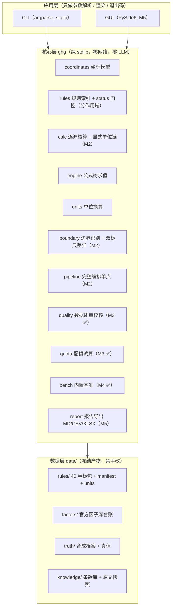

# 企业温室气体排放核算与报告工作台

> **组织碳核算工具**：把「活动数据 × 排放因子 → 可核证报告」整条链做成**可复现、可溯源、跨标准版本不混算**的本地工具。
> 规则内核 = **GB/T 32150 新旧双标尺 × 年度 × 行业** 三维版本化规则集；数据底座 = 官方排放因子库（第二版）。
> **全本地核算、零上传、零 LLM 依赖** —— 每一个数字都能追到来源，每一条数值都必须挂官方原文核对后才生效。

状态：✅ **M5 完成（2026-10-13）—— 桌面交付与可核证报告导出**。
`ghg report` 一次落盘**三产物**：Markdown（人读）+ 9 张 CSV + XLSX（机读），章节覆盖 §0 报告头 … §8 数据溯源表，
按需追加 §5 校核与 §6 配额章节；**溯源行数 == 明细 + 因子**且每条 `rule_entry_id` 可解析（不得导出"半溯源"报告），
机读产物**无外链**（断网可开、可归档），XLSX 用自研最小 writer（零第三方依赖）且**同输入逐字节一致**。
桌面形态 **PySide6 四页签**（核算 / 校核 / 配额 / 基准）**只消费引擎 API、零判定逻辑**（导入门禁锁定），
**offscreen 测试常驻**（无显示器也能跑）；**PyInstaller onedir 双 exe**（`ghg-cli` 13 MB / `ghg-gui` 101 MB），
`exe --selftest` 通过并断言**数据目录落在 dist 内**；随包数据走**显式白名单**（官方原文快照约 11 MB 是核对留档，不进包）。
演示素材（四页签离屏截图 + 命令行记录）由 `tools/gen_demo.py` 可复跑生成，落在 [docs/demo/](docs/demo/)；技术报告见 [docs/技术报告.md](docs/技术报告.md)。
`ghg bench` 一条命令跑全三类基准并输出指标：**规则自洽率 100%**（40 坐标包 × 12 项 = 480/480）、
**因子与单位一致率 100%**（116/116，含单位换算全量往返与跨量纲拒绝）、**异常用例命中率 100%**（12/12）与**误报率 0%**（8 个干净对照档案零命中），
单次全量 **≈ 0.04 秒**（NFR-11 要求 < 2 秒）；退出码 0 达标 / 1 未达标 / 2 用法错误。
验收门槛随 `manifest.bench.targets` 下发（**门槛是数据不是代码**），每套件另配**可证伪探活测试**（注入缺陷 → 基准必须报未达标）。
`ghg check` 按规则包 `quality.rules[].type` 分派**四类检查**（单位一致性 / 量级异常 / 跨年度突变 / 比强度合理性），
输出分级问题清单（错误 / 警告 / 提示，每条挂规则依据与建议），阈值全部取自规则包 `quality.thresholds`（代码零阈值字面量），校核层**只读**不改核算结果；
`ghg quota` 按行业方法学试算配额（发电基准法 / 三行业强度系数法 / 历史强度法 / 不适用），**方法学切换即切换公式分支**，
"平台可查"的行业平衡值与随机组而异的调峰修正系数按**外部输入显式索取**（缺失即退出码 2，绝不静默取 0），并**强制输出免责声明**。
校核路径与配额路径门控 **40/40 坐标可通过**；核算路径仍 **38/40**（2026 年度发电碳氧化率待官方因子库，站点 WAF 阻断）—— 这是"未核对不得生效"纪律的诚实留白，非缺陷。
**8 份核算算例 + 4 份校核异常算例 + 2 份配额算例全部与真值库对账**（含误报对照：同比未变化的档案不命中跨年突变检查）。

---

## 一、这个工具解决什么问题

全国碳市场完成发电行业起步后，**钢铁、水泥、铝冶炼已纳入扩围**；**GB/T 32150-2025 于 2026-07-01 实施**（替代 2015 版），企业正处**新旧核算标准切换期**。真实痛点不是"不会做乘法"，而是：

| 痛点 | 本工具的答案 |
|---|---|
| 新旧标准切换期，不敢断定"这版标准下要不要算这个源" | **双标尺排放源识别 + 差异提示**（新增/取消/口径调整自动标出） |
| 活动数据 × 排放因子人人会算，"错在哪一项"说不清 | **逐项留痕**：每行挂"活动数据来源 / 因子来源 / 规则条款"三元组 |
| 跨年度/跨行业规则包随手混用，算出来还不报错 | **三维坐标强约束**：跨坐标混算直接报错（退出码 2） |
| 用了不适用的缺省因子，核查时被挑出 | **因子来源优先级**（实测 > 官方因子库 > 行业缺省）+ 适用性检查 |
| 申报前不知道自家数据"像不像话" | **数据质量校核层**：单位一致性 / 量级异常 / 跨年突变 / 比强度合理性，分错误/警告/提示三级 |
| 配额算完和实际排放的缺口心里没底 | **配额试算**：按行业方法学（基准法 / 强度系数法）试算并给出履约缺口预判 + 强制免责声明 |
| 核查机构要"每个数字追到来源"，手工做一份溯源表要一天 | **一键可核证报告**（Markdown + CSV/XLSX，含数据溯源表） |

## 二、架构



**依赖铁律**：核心层不 import 应用层、不 import 第三方包；数据层只被读，唯一写入者是 `tools/gen_*.py`。

## 三、快速开始（CLI）

```bash
# 1. 安装（dev extras 含 pytest 与 PyYAML 守门）
cd code
python -m pip install -U pip
python -m pip install -e ".[dev]"
cd ..

# 2. 查看规则包坐标空间（通则版本 × 年度 × 行业 = 2 × 5 × 4 = 40）
python -c "import sys; sys.path.insert(0,'code/src'); from ghg.cli import main; sys.exit(main(['coords']))"

# 3. 规则包门控体检（按计算路径分作用域；核算路径 38/40 可通过，退出码 1 表示仍有坐标被拦）
python -c "import sys; sys.path.insert(0,'code/src'); from ghg.cli import main; sys.exit(main(['rules','check']))"

# 4. 单位换算（换算因子来自 data/rules/units.json，非代码内联）
python -c "import sys; sys.path.insert(0,'code/src'); from ghg.cli import main; sys.exit(main(['convert','--value','1','--from','t','--to','kg']))"

# 5. 端到端核算（合成档案 → 完整报告：报告头 / 边界 / 明细 / 因子表 / 溯源表；退出码 0）
python -c "import sys; sys.path.insert(0,'code/src'); from ghg.cli import main; sys.exit(main(['calc','--input','data/truth/profiles/steel-2024.json']))"

# 5b. 附带双标尺差异 + 落 Markdown 报告文件
python -c "import sys; sys.path.insert(0,'code/src'); from ghg.cli import main; sys.exit(main(['calc','--input','data/truth/profiles/steel-2024.json','--diff-standard','gbt32150-2015','--report','report.md']))"

# 5c. 数据质量校核（四类检查 + 分级问题清单；干净档案退出码 0，命中 error 则退出码 2）
python -c "import sys; sys.path.insert(0,'code/src'); from ghg.cli import main; sys.exit(main(['check','--input','data/truth/profiles/steel-2024.json']))"

# 5d. 跨年度突变检查（提供上一年度档案作为基线）
python -c "import sys; sys.path.insert(0,'code/src'); from ghg.cli import main; sys.exit(main(['check','--input','data/truth/profiles/steel-2024-yoy-jump.json','--baseline','data/truth/profiles/steel-2023-yoy-baseline.json']))"

# 5e. 配额试算（发电基准法；调峰修正系数属外部输入，须显式给出）
python -c "import sys; sys.path.insert(0,'code/src'); from ghg.cli import main; sys.exit(main(['quota','--input','data/truth/profiles/power-2025.json','--correction-factor','0.97']))"

# 5f. 配额试算（三行业强度系数法；行业平衡值属外部输入，须显式给出）
python -c "import sys; sys.path.insert(0,'code/src'); from ghg.cli import main; sys.exit(main(['quota','--input','data/truth/profiles/steel-2024.json','--benchmark-value','2.1']))"

# 6. 内建自检
python -c "import sys; sys.path.insert(0,'code/src'); from ghg.cli import main; sys.exit(main(['selftest']))"

# 6b. 可核证报告导出（三产物：Markdown + 9 张 CSV + XLSX；§5 校核 / §6 配额按需追加）
python -c "import sys; sys.path.insert(0,'code/src'); from ghg.cli import main; sys.exit(main(['report','--input','data/truth/profiles/steel-2024.json','--out-dir','.','--with-check','--with-quota','--benchmark-value','2','--output','166150']))"

# 7. 内置离线基准（三类全跑；退出码 0 达标 / 1 未达标 / 2 用法错误）
python -c "import sys; sys.path.insert(0,'code/src'); from ghg.cli import main; sys.exit(main(['bench']))"
python tools/bench.py                        # 等价入口（薄封装）
python tools/bench.py --suite rules          # 只跑指定套件（可重复）
```

### 三之二、桌面形态（GUI）与打包

```bash
# 1. 安装 gui extras（PySide6）
cd code && python -m pip install -e ".[gui]" && cd ..

# 2. 启动桌面界面（四页签：核算 / 校核 / 配额 / 基准；只消费引擎 API）
python -c "import sys; sys.path[:0]=['code/src','code/gui']; from ghg_gui.main import main; sys.exit(main())"

# 3. 无显示器环境也能跑（offscreen；测试常驻此模式）
QT_QPA_PLATFORM=offscreen python -c "import sys; sys.path[:0]=['code/src','code/gui']; from ghg_gui.main import main; sys.exit(main(['--selftest']))"

# 4. 打包双 exe（PyInstaller onedir；数据白名单取自 tools/ghg_packaging.py）
python -m pip install -e "code[build]"
python -m PyInstaller tools/ghg_cli.spec --noconfirm      # → dist/ghg-cli/ghg-cli.exe
python -m PyInstaller tools/ghg_gui.spec --noconfirm      # → dist/ghg-gui/ghg-gui.exe

# 5. 打包产物验收：数据目录必须落在 dist 内（冻结态专属断言）
./dist/ghg-cli/ghg-cli.exe --selftest

# 6. 重新生成演示素材（离屏截图 + 命令行记录，含退出码谱）
QT_QPA_PLATFORM=offscreen python tools/gen_demo.py       # → docs/demo/
```

> 注意必须写 `sys.exit(main(...))`：直接写 `main([...])` 不会把退出码传给 shell，`$?` 恒为 0（文档写"退出码 1"就会变成假话）。

安装后可直接用控制台脚本 `ghg coords` / `ghg rules check` / `ghg bench` / `ghg selftest`（若 `Scripts/` 未在 PATH，用上面的 `python -c` 形式）。

**退出码契约**（锁定，见 [plan/03](plan/03-架构与技术选型.md) §六）：

| 码 | 语义 |
|---|---|
| 0 | 成功 / 门控通过 / 基准达标 |
| 1 | **门控拦截**（规则包存在未核对条目）或**基准未达标** |
| 2 | 输入不可用 / 参数错误（坐标不存在、跨坐标混算、文件缺失） |

### 演示：门控与混算拦截

```bash
# 跨坐标混算 → 退出码 2
cat > /tmp/mixed.json <<'EOF'
{"coordinate": {"standard":"gbt32150-2025","year":2024,"industry":"steel"},
 "baseline":  {"standard":"gbt32150-2015","year":2022,"industry":"steel"}}
EOF
ghg calc --input /tmp/mixed.json   # → 错误：输入包含多个规则包坐标（跨坐标混算被拒），退出码 2
```

## 四、三维版本化规则集（技术核心）

规则包按 **`通则版本 × 年度 × 行业`** 组织，坐标空间一维化为 `data/rules/ruleset-<标准>-<年度>-<行业>.json`，由 `data/rules/manifest.json` **单点索引**（代码内零坐标字面量）：

| 维度 | 取值 |
|---|---|
| 通则版本 | `gbt32150-2015`（废止）、`gbt32150-2025`（现行） |
| 年度 | 2022 – 2026 |
| 行业 | 发电 power / 钢铁 steel / 水泥 cement / 铝冶炼 aluminum |

**三条硬纪律**：

1. **冻结产物**：`data/rules/**` 禁手改，改体例走 `tools/gen_*.py` 整目录重生成，配"再生成逐字节一致"守门测试（四生成器链式，53 份 JSON 逐份 sha256）；
2. **status 门控（按计算路径分作用域）**：每条数值挂 `status`（`verified`/`pending`），**`pending` 绝不进入其自身路径**。门控单点 `RulesIndex.effective_ruleset(coord, scope)` 分三条作用域——`calc`（核算）/ `quota`（配额）/ `check`（校核）各查各的块，互不牵连（见 [plan/06](plan/06-决策记录.md) D1-1）；
3. **零政策字面量**：`tools/check_zero_literals.py` 扫描引擎/CLI 源码（**含注释与 docstring**），出现规则包数值 token 即失败——杜绝"抄进代码的第二份真相"（M1 起 token 集非空，门禁真正生效）。

## 五、进度与评测

| 里程碑 | 内容 | 状态 |
|---|---|---|
| **M0** | 计划文档 00–06 定稿 + 可运行骨架（规则加载器 / 坐标门控 / 单位换算 / 公式求值 / CLI / 测试 / CI） | ✅ 2026-10-13 |
| **M1** | 数据先行：规则数值逐条挂官方原文核对 → `verified`；官方因子库台账；合成企业档案 + 真值库 | ✅ 2026-10-13 |
| **M2** | 核算引擎：边界识别 + 双标尺差异 + 显式单位换算 + 完整编排与溯源表 + 算例回归 100% | ✅ 2026-10-13 |
| **M3** | 校核层（四类数据质量检查 + 分级问题清单）与配额试算（方法学分支 + 免责声明强制） | ✅ 2026-10-13 |
| **M4** | 内置基准（规则自洽 / 因子与单位 / 边界用例），一条命令跑全，指标入 README | ✅ 2026-10-13 |
| M5 | 桌面交付：PySide6 + PyInstaller 双 exe + 可核证报告导出 + 技术报告 + 演示素材 | ✅ 2026-10-13 |
| M6 | 脱敏发布 GitHub + Release | ⬜ |

**测试状态**：`288 passed`（pytest；py3.8 与 py3.12 双跑；含门控分作用域、混算拦截、冻结字节守门、零字面量门禁探活、workflow 守门、**M1 双路真值对账 + 四生成器位级一致**、**M2 边界识别 / 双标尺差异 / 完整编排 / 溯源完整性 / 失败路径退出码**、**M3 四类校核命中与分级 / 只读层 / 阈值取自规则包 / 配额方法学分支与外部输入索取 / 免责声明强制 / 配额真值对账**、**M4 三类基准全绿 + 每套件可证伪探活 + 门槛取自 manifest + 只读/确定性**、**M5 报告三产物 / 溯源完整性 / 无外链 / XLSX 字节确定性 / GUI offscreen 四页签 / 界面导入门禁 / 打包白名单探活 / 冻结态数据定位 / 演示素材可复跑**）。

**评测基准**（M4 落地；`ghg bench` 一条命令跑全，退出码 0 达标 / 1 未达标 / 2 用法错误）：

| 基准 | 指标 | 目标 | 实测 |
|---|---|---|---|
| 规则自洽扫描 | 新旧通则 × 四行业 × 多年度公式与系数自洽率 | 100% | **100%**（480/480 项；40 包 × 12 项） |
| 因子与单位一致性 | 跨年变化 + 单位换算往返 + 因子单位可解析一致率 | 100% | **100%**（116/116 项） |
| 边界与异常用例 | 校核命中率 / 误报率 / 拦截准确率 | 命中 ≥95%、误报 0 | **命中 100%**（12/12 用例）；**误报 0%**（8 个干净对照档案零命中） |
| 全量运行时长 | 单次全量扫描（NFR-11 < 2 秒） | ≤ 2 秒 | **≈ 0.036 秒**（40 坐标 + 全用例；本机 py3.12） |

门槛（`manifest.bench.targets`）是**数据不是代码**：与零政策字面量同一条纪律，改门槛只改生成器常量并重生成 manifest，基准层不内联任何门槛数值（见 [plan/06](plan/06-决策记录.md) D4-1）。每个套件都配**可证伪探活测试**（注入表达式坏引用 / 跨年因子漂移 / 孤儿类别覆盖 / 干净档案误报 / 用例期望篡改 → 基准必须报未达标），避免"基准通过"其实是"基准什么都没查"。

## 六、目录结构

```
├─ plan/                计划与方法论留档（00–06 + HANDOFF-M1/M2/M3/M4/M5/M6）
├─ code/
│  ├─ pyproject.toml     包定义（核心零依赖；extras: dev / gui / build）
│  ├─ src/ghg/           核心层（stdlib only；report 报告导出 M5）
│  ├─ gui/ghg_gui/       桌面形态（PySide6；service 为唯一引擎调用点）
│  └─ tests/             测试（288 项）
├─ tools/
│  ├─ gen_rulesets.py            三维规则包确定性生成器
│  ├─ gen_factors.py             官方因子库台账生成器
│  ├─ gen_knowledge.py           条款库 + 快照 sha256 生成器
│  ├─ gen_synthetic.py           合成企业档案 + 真值库生成器（自研确定性 RNG）
│  ├─ gen_demo.py                演示素材生成器（离屏截图 + 命令行记录）
│  ├─ bench.py                   内置基准入口（薄封装 → ghg.cli bench）
│  ├─ check_zero_literals.py     零政策字面量门禁（扫引擎 + GUI）
│  ├─ ghg_packaging.py           打包数据白名单（单一真相源）
│  ├─ ghg_cli.spec / ghg_gui.spec  PyInstaller onedir 双 exe 规格
│  └─ entry_cli.py / entry_gui.py    打包入口脚本
├─ data/
│  ├─ rules/             40 坐标包 + manifest.json + units.json（冻结产物）
│  ├─ factors/           官方排放因子库台账（manifest.json）
│  ├─ truth/             合成企业档案 + 真值库（profiles/ + expected.json）
│  └─ knowledge/         条款库（clauses.json）+ 官方原文快照（raw/，不进发布包）
├─ docs/
│  ├─ 技术报告.md         设计取舍 / 门控机制 / 留白清单
│  └─ demo/              演示素材（四页签截图 + 命令行记录）
└─ .github/workflows/ci.yml
```

## 七、开发与验证

```bash
cd code
python -m pytest -q                              # 全量测试（288 项；GUI 测试自动 offscreen）
cd ..
python tools/check_zero_literals.py --selftest   # 零政策字面量门禁（含阳性对照；扫引擎 + GUI）
python tools/bench.py                            # 内置基准（三类全跑；退出码 0 达标）
python tools/gen_rulesets.py                     # 重生成规则包（应位级一致，git status 无变化）
python tools/gen_factors.py                      # 重生成因子库台账
python tools/gen_knowledge.py                    # 重生成条款库（含快照 sha256 对账）
python tools/gen_synthetic.py                    # 重生成合成档案 + 真值库（依赖 rules/）
QT_QPA_PLATFORM=offscreen python tools/gen_demo.py  # 重生成演示素材（docs/demo/）
python -m PyInstaller tools/ghg_cli.spec --noconfirm && python -m PyInstaller tools/ghg_gui.spec --noconfirm
./dist/ghg-cli/ghg-cli.exe --selftest            # 打包产物验收（数据目录须在 dist 内）
```

CI：三矩阵 `windows×{3.8, 3.12}` + `ubuntu×{3.12}`，`fetch-depth: 0`（历史类守门测试需要全量历史）。

## 八、限制与免责

- **M5 阶段限制**：`calc`（核算，38/40 坐标）、`check`（四类校核，40/40）、`quota`（配额试算，40/40）、`bench`（内置基准，三类全绿）、`report`（可核证报告，MD + 9 张 CSV + XLSX）、GUI 四页签与双 exe 均已落地。配额试算中"平台可查"的行业平衡值（BP）与随机组而异的调峰修正系数属**外部输入**（规则包标 `input_required`），须由调用方显式提供（`--benchmark-value` / `--correction-factor`），缺失即退出码 2，**绝不静默取 0 或 1**。2026 年度发电坐标因碳氧化率改由官方因子库取值（因子库站点 WAF 阻断未摘录）而保持 `pending`，核算被门控拦截 —— 这是"未核对不得生效"纪律的直接体现，非缺陷（基准的"规则自洽率 100%"指 40 包**结构自洽**，与"核算路径 38/40 可通过"是两回事）。官方因子库（第二版）`official_db` 层暂无摘录条目，引擎侧该层由企业档案显式因子承担（机制已验证）。**发布包不含官方原文快照**（`data/knowledge/raw/`，核对留档，约 11 MB）；需复核数值出处者请用仓库全量数据。
- **首期范围**：发电 / 钢铁 / 水泥 / 铝冶炼四行业 + GB/T 32150 新旧两版通则；其余行业以新增坐标扩展。
- **不做**：产品碳足迹（PCF）核算、碳交易撮合、CCER 项目开发、实验室检测、对接主管部门申报接口。
- **数据纪律**：合成企业档案与真值为程序化自建，**不含任何真实企业数据**；官方因子逐条登记来源 URL 与版本。
- **免责声明**：本工具输出仅供企业内部参考，**正式排放数据以主管部门核定结果、第三方核查机构结论为准**；配额试算不构成任何配额分配承诺。

## 九、已知环境问题

- **Python 3.8 为下限**：核心层只用 3.8 兼容语法；`Path.write_text(newline=)` 是 3.10+ 参数，本仓库统一走 `write_bytes`。
- **Windows 控制台编码**：CLI 入口 `_ensure_utf8_stdio()` 按流编码探针 reconfigure，避免 cp1252/pipeline 下中文输出崩 `UnicodeEncodeError`。
- **冻结产物 CR 漂移**：`.gitattributes` 只 `eol=lf` 管不住脚本写盘；生成器一律 `write_bytes`，并有"无 CR 字节"守门测试。
- **`py` 启动器会无视 venv**：README 的安装段一律用 `python -m pip ...`（venv 激活后 `python` 才指向 venv）。

## 十、许可

MIT，见 [LICENSE](LICENSE)。计划与决策留档见 [plan/](plan/00-README总览.md)。
