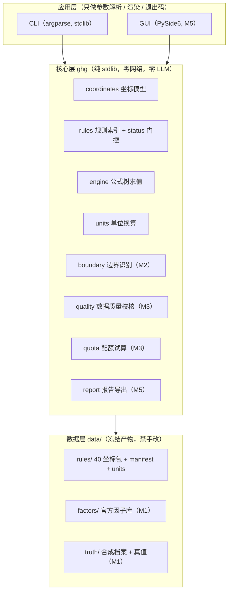

# 企业温室气体排放核算与报告工作台

> **组织碳核算工具**：把「活动数据 × 排放因子 → 可核证报告」整条链做成**可复现、可溯源、跨标准版本不混算**的本地工具。
> 规则内核 = **GB/T 32150 新旧双标尺 × 年度 × 行业** 三维版本化规则集；数据底座 = 官方排放因子库（第二版）。
> **全本地核算、零上传、零 LLM 依赖** —— 每一个数字都能追到来源，每一条数值都必须挂官方原文核对后才生效。

状态：🚧 **M0 完成（2026-10-13）—— 计划定稿 + 可运行骨架**（规则加载器 / 坐标门控 / 单位换算 / CLI / 测试 / CI）。
规则数值与条款号由 M1 逐条核对后填回；**当前 `calc` 会被门控拦截，这是刻意设计的诚实初态**。

---

## 一、这个工具解决什么问题

全国碳市场完成发电行业起步后，**钢铁、水泥、铝冶炼已纳入扩围**；**GB/T 32150-2025 于 2026-07-01 实施**（替代 2015 版），企业正处**新旧核算标准切换期**。真实痛点不是"不会做乘法"，而是：

| 痛点 | 本工具的答案 |
|---|---|
| 新旧标准切换期，不敢断定"这版标准下要不要算这个源" | **双标尺排放源识别 + 差异提示**（新增/取消/口径调整自动标出） |
| 活动数据 × 排放因子人人会算，"错在哪一项"说不清 | **逐项留痕**：每行挂"活动数据来源 / 因子来源 / 规则条款"三元组 |
| 跨年度/跨行业规则包随手混用，算出来还不报错 | **三维坐标强约束**：跨坐标混算直接报错（退出码 2） |
| 用了不适用的缺省因子，核查时被挑出 | **因子来源优先级**（实测 > 官方因子库 > 行业缺省）+ 适用性检查 |
| 核查机构要"每个数字追到来源"，手工做一份溯源表要一天 | **一键可核证报告**（Markdown + CSV/XLSX，含数据溯源表） |

## 二、架构



**依赖铁律**：核心层不 import 应用层、不 import 第三方包；数据层只被读，唯一写入者是 `tools/gen_*.py`。

## 三、快速开始（CLI）

```bash
# 1. 安装（dev extras 含 pytest 与 PyYAML 守门）
cd code
python -m pip install -U pip
python -m pip install -e ".[dev]"
cd ..

# 2. 查看规则包坐标空间（通则版本 × 年度 × 行业 = 2 × 5 × 4 = 40）
python -c "import sys; sys.path.insert(0,'code/src'); from ghg.cli import main; sys.exit(main(['coords']))"

# 3. 规则包门控体检（全部坐标被拦截 → 退出码 1，这是 M0 的预期行为）
python -c "import sys; sys.path.insert(0,'code/src'); from ghg.cli import main; sys.exit(main(['rules','check']))"

# 4. 单位换算（换算因子来自 data/rules/units.json，非代码内联）
python -c "import sys; sys.path.insert(0,'code/src'); from ghg.cli import main; sys.exit(main(['convert','--value','1','--from','t','--to','kg']))"

# 5. 内建自检
python -c "import sys; sys.path.insert(0,'code/src'); from ghg.cli import main; sys.exit(main(['selftest']))"
```

> 注意必须写 `sys.exit(main(...))`：直接写 `main([...])` 不会把退出码传给 shell，`$?` 恒为 0（文档写"退出码 1"就会变成假话）。

安装后可直接用控制台脚本 `ghg coords` / `ghg rules check` / `ghg selftest`（若 `Scripts/` 未在 PATH，用上面的 `python -c` 形式）。

**退出码契约**（锁定，见 [plan/03](plan/03-架构与技术选型.md) §六）：

| 码 | 语义 |
|---|---|
| 0 | 成功 / 门控通过 / 基准达标 |
| 1 | **门控拦截**（规则包存在未核对条目） |
| 2 | 输入不可用 / 参数错误（坐标不存在、跨坐标混算、文件缺失） |

### 演示：门控与混算拦截

```bash
# 跨坐标混算 → 退出码 2
cat > /tmp/mixed.json <<'EOF'
{"coordinate": {"standard":"gbt32150-2025","year":2024,"industry":"steel"},
 "baseline":  {"standard":"gbt32150-2015","year":2022,"industry":"steel"}}
EOF
ghg calc --input /tmp/mixed.json   # → 错误：输入包含多个规则包坐标（跨坐标混算被拒），退出码 2
```

## 四、三维版本化规则集（技术核心）

规则包按 **`通则版本 × 年度 × 行业`** 组织，坐标空间一维化为 `data/rules/ruleset-<标准>-<年度>-<行业>.json`，由 `data/rules/manifest.json` **单点索引**（代码内零坐标字面量）：

| 维度 | 取值 |
|---|---|
| 通则版本 | `gbt32150-2015`（废止）、`gbt32150-2025`（现行） |
| 年度 | 2022 – 2026 |
| 行业 | 发电 power / 钢铁 steel / 水泥 cement / 铝冶炼 aluminum |

**三条硬纪律**：

1. **冻结产物**：`data/rules/**` 禁手改，改体例走 `tools/gen_rulesets.py` 整目录重生成，配"再生成逐字节一致"守门测试；
2. **status 门控**：每条数值挂 `status`（`verified`/`pending`），**`pending` 绝不进入计算路径**——单点门控 `RulesIndex.effective_ruleset()` 拦截（CLI 预览仍可看）；
3. **零政策字面量**：`tools/check_zero_literals.py` 扫描引擎/CLI/工具源码（**含注释与 docstring**），出现规则包数值 token 即失败——杜绝"抄进代码的第二份真相"。

## 五、进度与评测

| 里程碑 | 内容 | 状态 |
|---|---|---|
| **M0** | 计划文档 00–06 定稿 + 可运行骨架（规则加载器 / 坐标门控 / 单位换算 / 公式求值 / CLI / 测试 / CI） | ✅ 2026-10-13 |
| M1 | 数据先行：规则数值逐条挂原文核对 → `verified`；官方因子库入库；合成企业档案 + 真值库 | ⬜ |
| M2 | 核算引擎：边界识别 + 双标尺差异 + 活动数据×因子 + 算例回归 100% | ⬜ |
| M3 | 校核层与配额试算 | ⬜ |
| M4 | 内置基准（规则自洽 / 因子一致性 / 边界用例），指标入 README | ⬜ |
| M5 | 桌面交付：PySide6 + PyInstaller 双 exe + 可核证报告导出 + 技术报告 | ⬜ |
| M6 | 脱敏发布 GitHub + Release | ⬜ |

**M0 测试状态**：`99 passed`（pytest；含门控正/负路径、混算拦截、冻结字节守门、零字面量门禁探活、workflow 守门）。
**评测基准**（M4 落地，指标将入下表）：

| 基准 | 指标 | 目标 | 现状 |
|---|---|---|---|
| 规则自洽扫描 | 新旧通则 × 四行业 × 多年度公式与系数自洽率 | 100% | ⬜ M4 |
| 因子库一致性 | 跨年变化 + 单位换算往返一致率 | 100% | ⬜ M4 |
| 边界与异常用例 | 校核命中率 / 误报率 / 拦截准确率 | 命中 ≥95%、误报 0 | ⬜ M4 |

## 六、目录结构

```
├─ plan/                计划与方法论留档（00–06 + HANDOFF-M1）
├─ code/
│  ├─ pyproject.toml     包定义（核心零依赖；extras: dev / gui / build）
│  ├─ src/ghg/           核心层（stdlib only）
│  └─ tests/             测试（99 项）
├─ tools/
│  ├─ gen_rulesets.py            三维规则包确定性生成器
│  └─ check_zero_literals.py     零政策字面量门禁
├─ data/
│  ├─ rules/             40 坐标包 + manifest.json + units.json（冻结产物）
│  ├─ factors/           官方排放因子库摘录（M1）
│  ├─ truth/             合成企业档案 + 真值库（M1）
│  └─ knowledge/         条款库 + 官方原文快照（M1）
└─ .github/workflows/ci.yml
```

## 七、开发与验证

```bash
cd code
python -m pytest -q                              # 全量测试（99 项）
cd ..
python tools/check_zero_literals.py --selftest   # 零政策字面量门禁（含阳性对照）
python tools/gen_rulesets.py                     # 重生成规则包（应位级一致，git status 无变化）
```

CI：三矩阵 `windows×{3.8, 3.12}` + `ubuntu×{3.12}`，`fetch-depth: 0`（历史类守门测试需要全量历史）。

## 八、限制与免责

- **M0 阶段限制**：`calc` / `check` 仅做门控与输入校验，**尚不出数**（计算引擎 M2、校核层 M3）；当前全部规则条目 `pending`，故门控必然拦截——这是"未核对不得生效"纪律的直接体现，非缺陷。
- **首期范围**：发电 / 钢铁 / 水泥 / 铝冶炼四行业 + GB/T 32150 新旧两版通则；其余行业以新增坐标扩展。
- **不做**：产品碳足迹（PCF）核算、碳交易撮合、CCER 项目开发、实验室检测、对接主管部门申报接口。
- **数据纪律**：合成企业档案与真值为程序化自建，**不含任何真实企业数据**；官方因子逐条登记来源 URL 与版本。
- **免责声明**：本工具输出仅供企业内部参考，**正式排放数据以主管部门核定结果、第三方核查机构结论为准**；配额试算不构成任何配额分配承诺。

## 九、已知环境问题

- **Python 3.8 为下限**：核心层只用 3.8 兼容语法；`Path.write_text(newline=)` 是 3.10+ 参数，本仓库统一走 `write_bytes`。
- **Windows 控制台编码**：CLI 入口 `_ensure_utf8_stdio()` 按流编码探针 reconfigure，避免 cp1252/pipeline 下中文输出崩 `UnicodeEncodeError`。
- **冻结产物 CR 漂移**：`.gitattributes` 只 `eol=lf` 管不住脚本写盘；生成器一律 `write_bytes`，并有"无 CR 字节"守门测试。
- **`py` 启动器会无视 venv**：README 的安装段一律用 `python -m pip ...`（venv 激活后 `python` 才指向 venv）。

## 十、许可

MIT，见 [LICENSE](LICENSE)。计划与决策留档见 [plan/](plan/00-README总览.md)。
